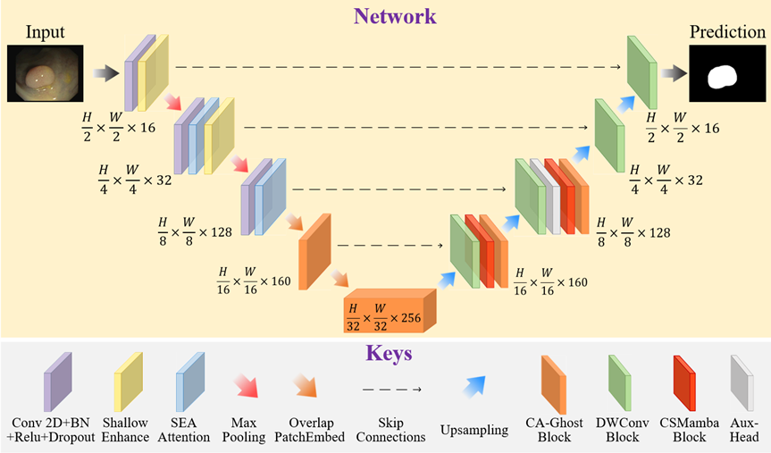

# CSMamba-UNeXt
> Mamba-based Precise Segmentation Network for Colonic Polyps

# Introduction
CSMamba-UNeXt is built upon a UNeXt-based multi-layer encoder-decoder architecture, integrating Mamba state-space modeling to achieve efficient feature representation and cross-scale fusion through modular design (Fig. 1). The network adopts a four-stage hierarchical structure in both encoder and decoder, with channel dimensions C_1=16, C_2=32, C_3=128, and C_4=160.


# Using the code:
The code is stable while using Python 3.8, CUDA 11.8

To install all the dependencies using conda:

>conda env create -f environment.yml
>
>conda activate unext

---
# Data Format
Make sure to put the files as the following structure (e.g. the number of classes is 2):
```
.
inputs
└── <dataset name>
    ├── images
    |   ├── 001.png
    │   ├── 002.png
    │   ├── 003.png
    │   ├── ...
    |
    └── masks
        ├── 0
        |   ├── 001.png
        |   ├── 002.png
        |   ├── 003.png
        |   ├── ...
        |
        └── 1
            ├── 001.png
            ├── 002.png
            ├── 003.png
            ├── ...
```
For binary segmentation problems, just use folder 0.


---
# Training and Validation  
1.Train the model.
>python train.py --dataset <dataset name> --arch CSMamba-UNeXt --name <exp name> --img_ext .png --mask_ext .png --lr 0.0001 --epochs 500 --input_w 512 --input_h 512 --b 8

2.Evaluate.
>python val.py --name <exp name>